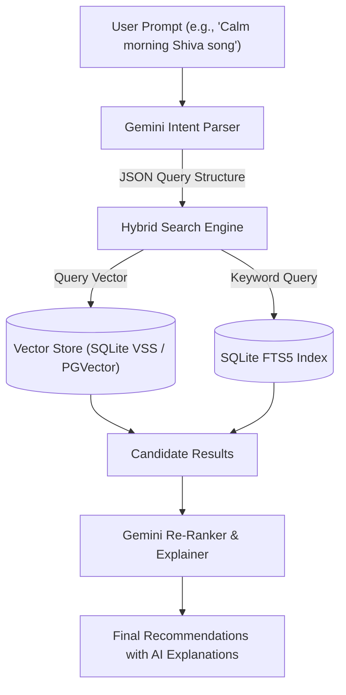
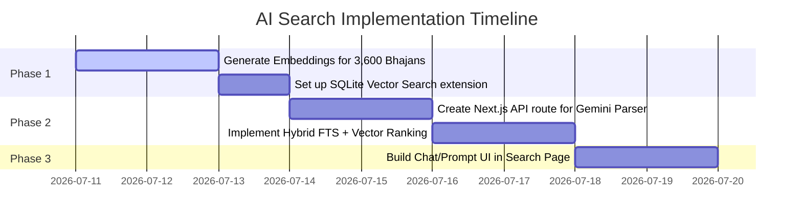

# Architecture Brainstorm: AI Supercharged Search

This document outlines a premium, modern architecture to implement an AI-powered search and recommendation system for **ISai Bhajan Studio**. It is designed to handle complex queries that normal filters cannot resolve, such as looking for forgotten songs by description or matching specific devotional moods.

---

## 1. The Core Architecture (Hybrid Search Pipeline)

To make search feel truly "supercharged," we combine standard keyword indexing with semantic vector embeddings and LLM intent parsing:



---

## 2. Deep Dive: Key AI Mechanics

### A. The Intent Parser (Structured Extraction)
We use the Gemini API with structured JSON output (schema-enforced) to parse natural language prompts.
* **Example Prompt:** *"I need a slow, peaceful Shiva bhajan that I can sing in the morning. I don't want anything too fast."*
* **Gemini Output:**
  ```json
  {
    "deity": "shiva",
    "tempo": "slow",
    "mood": "meditative",
    "time_of_day": "morning",
    "semantic_tags": ["peace", "silence", "surrender"]
  }
  ```

### B. Semantic Vector Search (Fuzzy & Forgetful Queries)
Sathya Sai Bhajans contain deep Sanskrit/regional lyrics. If a user says: *"A song about Lord Krishna dancing with gopis near the river"*, traditional keyword search would fail if those exact English words aren't in the lyrics.
* **Solution:** Generate high-dimensional vector embeddings (768-dim) for every bhajan using the Gemini Embedding API.
* We embed a joined string of the bhajan's metadata:
  `Title: [title] | Deity: [deity] | Raga: [raga] | Lyrics: [lyrics] | Meaning: [meaning]`
* When a user searches, we convert their prompt into an embedding vector and run a **cosine similarity** check to find matches that share the same *meaning* or *story*, regardless of the exact spelling or language.

### C. Re-Ranking & Explanations
Instead of just showing a table of results, the AI can explain *why* it recommended a particular song:
* **Recommendation:** *Siva Sivaya Namah Om*
* **AI Explanation:** *"This is a slow, meditative Shiva bhajan that invokes the peaceful silence of Mount Kailash. Its simple rhythm makes it ideal for an early morning session."*

---

## 3. Implementation Steps



---

## 4. Next Brainstorming Steps

> [IMPORTANT]
> **Which aspect of this AI search should we focus on designing first?**
> * **Option 1 (Recommended):** The **Database Embedding Pipeline** (writing the Python script to batch-generate embeddings for your 3,600+ bhajans and store them in SQLite).
> * **Option 2:** The **Intent Parser Route** (implementing the Gemini endpoint in the Next.js/FastAPI backend to parse prompts into structured filter criteria).
> * **Option 3:** The **AI Setlist Assistant** (designing a specific prompt/interface to let users generate entire 1-hour session lists automatically).
