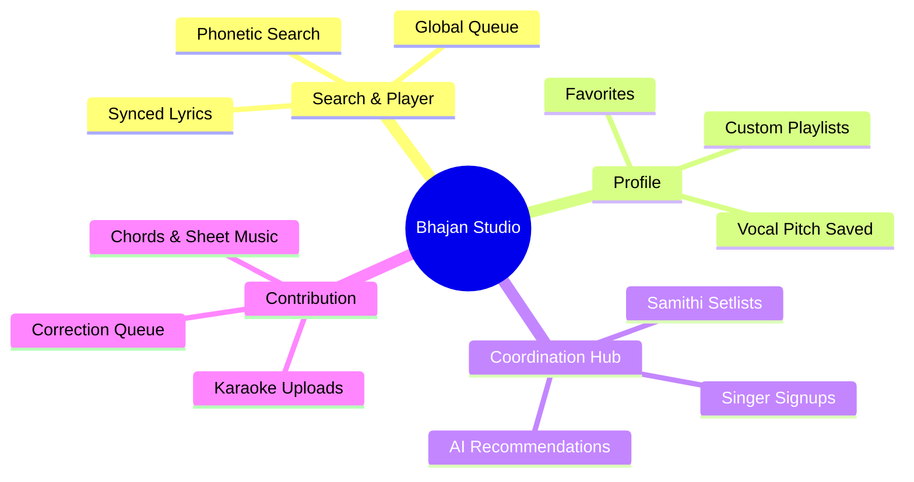

# Feature Roadmap: ISai Bhajan Studio

This roadmap outlines concrete, high-impact features we can build to transition the **Profile**, **Coordinate**, and **Contribute** pages from placeholders into functional, premium, community-driven experiences.

---

## 1. The Core Modules

---

## 2. Deep Dive: Brainstormed Features

### A. Coordination Hub (`/coordinate`)
Currently, local devotional groups (Samithis) coordinate sessions manually via text messages. We can build:
* **Interactive Setlist Planner:** A tool where users can build a sequence of bhajans for an upcoming session (e.g. 5:00 PM Thursday Session).
* **AI Setlist Architect (Gemini-Powered):** 
  * Recommend setlists that respect traditional structures (e.g., starts with *Ganesha*, moves to *Guru/Devi/Shiva*, ends with *Sarva Dharma*).
  * Automatically balance tempos (e.g. slow starting, rising to a fast climax, returning to peaceful slow).
* **Singer Allocation:** Let singers RSVP and sign up for specific slots (e.g., "Sai Ram is singing Ganesha Sharanam").

### B. Profile & Personalization (`/profile`)
To support individual practice and session preparation:
* **Firebase Auth Integration:** Simple sign-in with Google or Apple.
* **Favorites / Liked List:** A persistent "Heart" icon on search results and players that saves favorite bhajans to a quick-access tab.
* **Key/Scale Preferences:** Let users save their vocal scale (e.g., "Male C#", "Female G"). The app can flag if a bhajan matches their range.
* **My Playlists:** Create, name, and order custom lists of bhajans.

### C. Contribution Engine (`/contribute`)
Crowdsource content updates securely:
* **Chord Sheets & Harmonium Sheets:** Allow users to upload guitar/harmonium chords or western/carnatic sheet music.
* **Lyric Correction Forms:** If there is a typo in a bhajan, users can submit a suggested correction which gets saved in a queue.
* **Karaoke / Practice Tracks:** Let users upload instrumental-only tracks for practitioners to sing along with.

### D. Media & Playback Enhancements (Global)
* **Gapless Playback & Queue:** Allow users to build a playback queue (e.g., "Play Next", "Add to Queue") so songs flow continuously.
* **Lyrics Meaning tooltips:** Hovering over Sanskrit words (e.g., *Sambhuta*, *Karuna*) shows a popup with their literal translation.
* **Chords Overlay:** Toggle a sheet music/chord helper directly on the `/now-playing` page under the lyrics.

### E. Advanced Practice & Presentation Tools (Vocal & Temple Practice)
* **HTML5 Web Audio Visualizer:** A glowing, interactive frequency wave visualizer on `/now-playing` that animates dynamically in sync with the audio.
* **Audio Key Transposer (Pitch Shifter):** Integrate real-time pitch shifting using Web Audio API so singers can transpose any bhajan audio up or down by semitones to perfectly fit their vocal scale (e.g. shift from D to C# or E).
* **PWA Offline Mode:** Turn the application into a Progressive Web App that caches audio and lyrics locally, allowing full functionality inside temples/halls with no internet connection.
* **Session Slideshow / TV Projection Mode:** A full-screen, high-contrast, large-font scrolling mode designed to project lyrics onto a screen for congregations.
* ** Harmonium Starting Note Pitcher:** A small interactive keyboard widget that plays the starting note (key chord) of the bhajan to guide the singer before they start.

---

## 3. Interactive Prioritization

> [!TIP]
> **Which module would you like us to start building first?**
> * **Option 1:** **Profile & Favorites** (Implementing Firestore/Local Storage to save liked songs and custom playlists).
> * **Option 2:** **Coordination Hub** (Allowing users to build a setlist and assign singers).
> * **Option 3:** **Contribute / Correction Engine** (Allowing users to edit lyrics or upload sheets).
> * **Option 4:** **Advanced Vocal Tools** (Implementing the real-time pitch transposer, harmonium pitch starter, and Web Audio visualizer).
